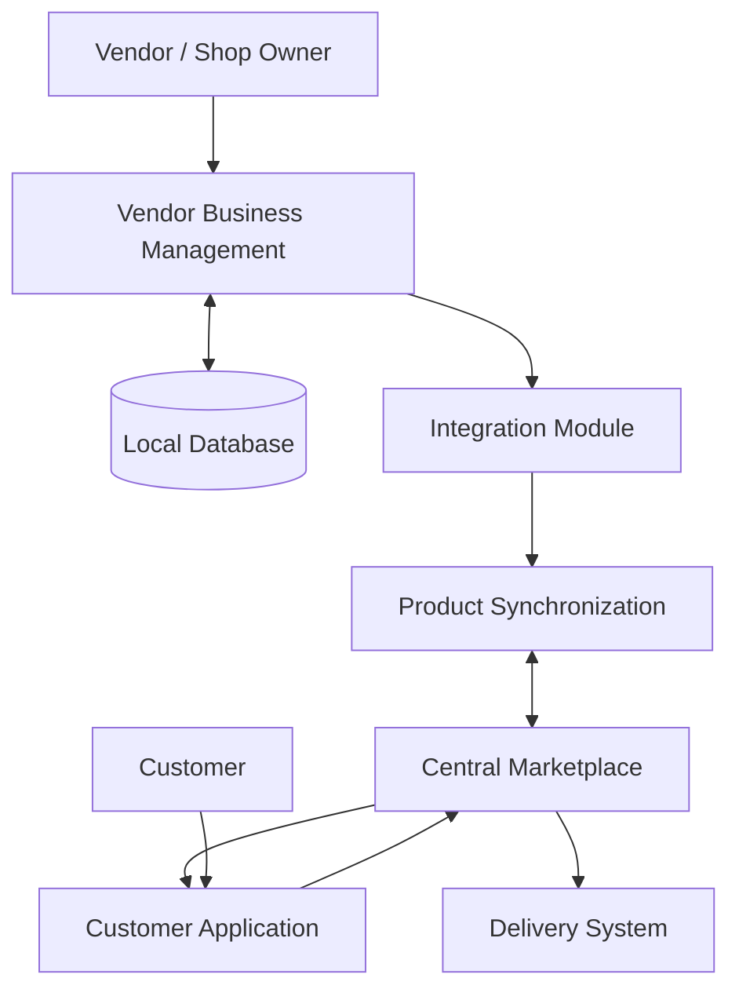
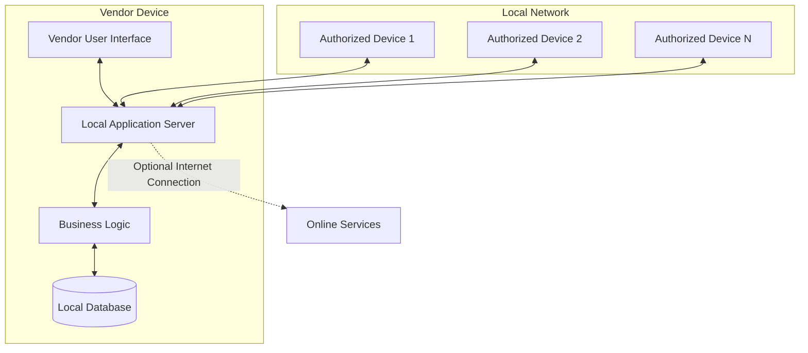
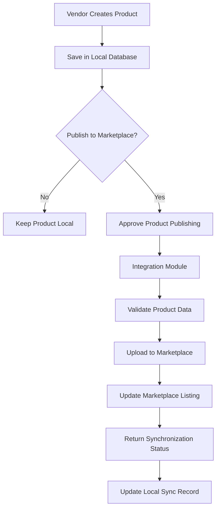
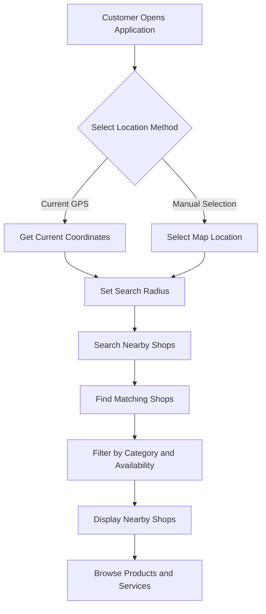
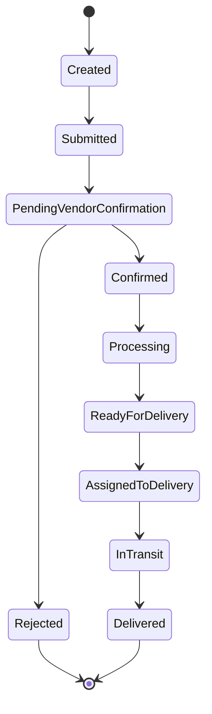
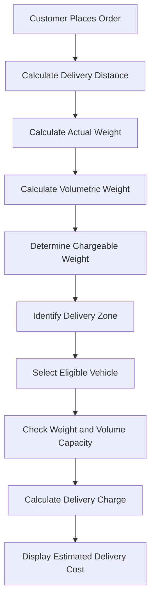
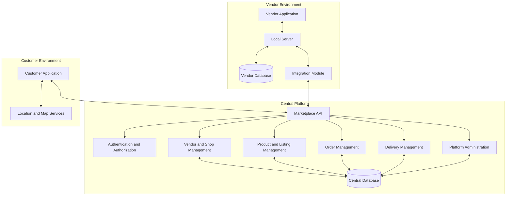

# Local Commerce & Nearby Business Network

A location-based commerce ecosystem that connects local shops, independent vendors, and customers through a unified digital platform.

The platform combines **local-first business management**, **nearby shop discovery**, **online storefronts**, and **smart delivery management** into one connected ecosystem.

---

## Table of Contents

- [Overview](#overview)
- [Business Ecosystem](#business-ecosystem)
- [Platform Components](#platform-components)
- [1. Vendor Business Management Application](#1-vendor-business-management-application)
- [2. Nearby Shop Marketplace](#2-nearby-shop-marketplace)
- [3. Customer Application](#3-customer-application)
- [Product Synchronization](#product-synchronization)
- [Location-Based Discovery](#location-based-discovery)
- [Order Management](#order-management)
- [Smart Delivery Calculation](#smart-delivery-calculation)
- [Product Classification](#product-classification)
- [System Architecture](#system-architecture)
- [Revenue Model](#revenue-model)
- [Core Architectural Principles](#core-architectural-principles)
- [Future Scope](#future-scope)

---

## Overview

The platform is designed around three primary business components:

1. **Vendor Business Management Application** — A standalone business management system that vendors can operate locally.
2. **Nearby Shop Marketplace** — A centralized marketplace where vendors can publish approved products and services.
3. **Customer Application** — An application for discovering nearby shops, exploring products, and placing online orders.

Vendors retain control over their own business data while optionally connecting to the centralized marketplace.

### Key Objectives

- Enable independent vendors to manage their businesses.
- Support offline-first business operations.
- Connect nearby shops with local customers.
- Allow vendors to publish their own online storefronts.
- Synchronize approved products with the central marketplace.
- Support both physical-store purchases and online orders.
- Calculate delivery charges using distance, weight, volume, and vehicle capacity.

---

## Business Ecosystem



---

## Platform Components

| Component | Responsibility |
|---|---|
| Vendor Application | Local business operations and management |
| Local Server | Handles local API requests and business services |
| Local Database | Stores vendor-owned business data |
| Integration Module | Connects the vendor system to the marketplace |
| Central Marketplace | Manages published shops, listings, and marketplace orders |
| Customer Application | Shop discovery, product browsing, and ordering |
| Delivery System | Delivery assignment, routing, and charge calculation |
| Platform Administration | Central platform configuration and supervision |

---

## 1. Vendor Business Management Application

The vendor application is an independent business management system that can operate without an internet connection.

### Supported Platforms

- Android
- iOS
- Windows
- Linux

### Operating Model

The application runs a local server and database on the vendor's device or computer.

Other authorized devices can connect to the local server through a local network.

### Core Capabilities

- Product and inventory management
- Purchase and sales management
- Customer management
- Supplier management
- Accounting and financial records
- Staff and user permissions
- Invoice and voucher generation
- Reports and analytics
- Local data backup
- Optional online storefront
- Optional marketplace integration

### Vendor Architecture



### Local-First Operation

The vendor application must remain functional even when the internet connection is unavailable.

Local business transactions are stored in the local database. Online synchronization is handled separately through the integration module.

---

## 2. Nearby Shop Marketplace

The central marketplace connects independent shops and vendors with customers.

### Marketplace Capabilities

- Vendor registration
- Shop profile management
- Shop location management
- Product and service publishing
- Product search and discovery
- Category-based browsing
- Nearby shop discovery
- Online order management
- Vendor availability status
- Marketplace administration

### Vendor Publishing Model

Vendors decide which products or services they want to publish.

Only explicitly approved listings are synchronized to the central marketplace.

The vendor's entire local database is not exposed to the marketplace.

---

## 3. Customer Application

The customer application provides access to nearby shops, products, and services.

### Main Features

- GPS-based location detection
- Manual map location selection
- Search radius selection
- Nearby shop discovery
- Product and category search
- Shop profile and product browsing
- Physical shop visit information
- Online shopping
- Delivery address management
- Order tracking
- Order history

### Customer Purchase Options

Customers can choose between:

**Physical Store Purchase**
- Discover a nearby shop.
- View shop information and products.
- Visit the physical store.
- Purchase directly from the shop.

**Online Purchase**
- Select products from participating shops.
- Submit an online order.
- Provide an accepted delivery address.
- Receive delivery through the available delivery service.

---

## Product Synchronization

The integration module connects the vendor's local business system with the central marketplace.

### Synchronization Workflow



### Synchronization Responsibilities

| Data | Synchronization |
|---|---|
| Product Name | Approved product data |
| Product Description | Approved product data |
| Product Images | Approved media |
| Category | Marketplace category mapping |
| Selling Price | Vendor-authorized price |
| Stock Status | Published availability |
| Shop Information | Approved shop profile |
| Product Status | Active, inactive, or unavailable |

### Synchronization Requirements

- Explicit vendor publishing permission
- Secure API communication
- Product version tracking
- Conflict detection
- Retry handling
- Synchronization status tracking
- Price and stock update handling
- Duplicate prevention

The vendor's local database remains the primary source of truth for local business operations.

---

## Location-Based Discovery

Customers can discover nearby shops using either their current GPS location or a manually selected location on the map.

### Search Parameters

- Customer coordinates
- Selected map coordinates
- Search radius
- Shop location
- Shop availability
- Product or service category

### Discovery Workflow



---

## Order Management

The platform supports online orders from participating vendors.

### Order Lifecycle



### Offline Vendor Handling

When a vendor's local server is offline:

- The marketplace can retain the incoming order.
- The order remains pending vendor confirmation.
- The integration module synchronizes the order when the vendor reconnects.
- The vendor confirms or rejects the order.
- The marketplace updates the customer-facing order status.

Order acceptance and stock reservation rules must be coordinated to avoid overselling.

---

## Smart Delivery Calculation

Delivery charges should consider more than straight-line distance.

### Delivery Factors

- Delivery distance
- Actual package weight
- Volumetric weight
- Package dimensions
- Vehicle type
- Vehicle weight capacity
- Vehicle volume capacity
- Delivery zone
- Base delivery fee
- Additional service charges

### Volumetric Weight

A common volumetric-weight formula is:

\[
W_v = \frac{L \times W \times H}{K}
\]

Where:

- `L` = Package length
- `W` = Package width
- `H` = Package height
- `K` = Volumetric conversion factor
- `Wv` = Volumetric weight

Chargeable weight:

\[
W_c = \max(W_a, W_v)
\]

Where:

- `Wa` = Actual weight
- `Wv` = Volumetric weight
- `Wc` = Chargeable weight

The conversion factor and measurement units must be configurable according to the delivery provider.

### Delivery Calculation Workflow



### Vehicle Capacity Validation

A delivery assignment must satisfy both weight and volume constraints.

```text
Package Weight <= Vehicle Weight Capacity
Package Volume <= Vehicle Volume Capacity
```

If no eligible vehicle is available, the delivery request should remain pending or be assigned to another delivery option.

---

## Product Classification

The platform uses a hierarchical classification system.

```text
Main Category
    └── Subcategory
          └── Item
```

The current `Category.json` taxonomy contains 20 main categories.

### Main Categories

1. Transport & Logistics
2. Food & Beverage
3. Education & Training
4. Service Industry
5. Raw Materials & Resources
6. Machinery & Equipment
7. Properties & Real Estate
8. Culture & Heritage
9. Social & Community
10. Agriculture & Farming
11. Health & Medicine
12. Lifestyle & Fashion
13. Scrap & Recycling
14. Entertainment & Media
15. Hobbies & Leisure
16. Electronic & Technology
17. Finance & Banking
18. Energy & Environment
19. Construction & Infrastructure
20. Government & Public Administration

### Listing Types

Not every marketplace listing represents a physical product.

The platform should distinguish between:

| Listing Type | Description |
|---|---|
| Physical Product | A tangible item available for purchase |
| Digital Product | A digitally delivered item |
| Service | A service offered by a business |
| Business Listing | A business or organization profile |
| Property Listing | Property available for sale or rent |
| Transport Listing | Transport or logistics-related offering |

This separation allows the platform to support diverse business categories without forcing every listing into a product-and-stock model.

---

## System Architecture



### Architectural Separation

The vendor environment and central platform have separate responsibilities and databases.

| Vendor Environment | Central Platform |
|---|---|
| Local business records | Marketplace listings |
| Purchase and sales | Marketplace orders |
| Local inventory | Published stock status |
| Local accounting | Platform financial records |
| Vendor permissions | Platform-level permissions |
| Local reports | Marketplace analytics |

---

## Revenue Model

Potential revenue streams include:

| Revenue Source | Description |
|---|---|
| Vendor Subscription | Optional subscription for premium vendor services |
| Marketplace Commission | Commission on eligible marketplace transactions |
| Featured Listings | Paid promotional placement |
| Advertising | Sponsored shops and listings |
| Delivery Service Fee | Platform service fee for delivery coordination |
| Premium Storefront | Optional advanced online storefront features |
| Business Services | Optional additional business tools |

Revenue rules should be configurable and transparent to vendors.

---

## Core Architectural Principles

1. **Local-First:** Vendor business operations must work without internet access.
2. **Vendor Data Ownership:** Vendors retain control over their local business data.
3. **Explicit Publishing:** Only vendor-approved listings are published to the marketplace.
4. **Independent Systems:** Vendor applications and the central marketplace remain separate systems.
5. **Optional Integration:** Marketplace connectivity is an optional capability.
6. **Independent Storefront:** A vendor's personal online store and marketplace publishing are separate capabilities.
7. **Controlled Synchronization:** Product, price, stock, and order synchronization must be version-aware.
8. **Multi-Platform Support:** Vendor management should support Android, iOS, Windows, and Linux.
9. **Location-Aware Discovery:** Customer search should support GPS and manually selected locations.
10. **Flexible Delivery:** Delivery calculation should support different vehicles, zones, weights, and package dimensions.
11. **Extensible Classification:** The category system should support products, services, and other listing types.
12. **Security:** Authentication, authorization, data validation, and secure communication are required across system boundaries.

---

## Future Scope

Potential future capabilities include:

- Multi-vendor marketplace expansion
- Multiple branches per vendor
- Multi-warehouse inventory
- Advanced delivery partner integration
- Delivery route optimization
- Customer loyalty and rewards
- Vendor analytics and business intelligence
- Promotional campaigns and discount management
- Payment gateway integration
- Advanced marketplace search
- Multi-language support
- Multi-currency support

---

## Project Status

This repository describes the proposed business model and high-level system architecture.

Implementation details, technology selection, database schemas, API contracts, deployment configuration, and development milestones can be documented as the project evolves.

---

## License

License information will be added when the project license is selected.
