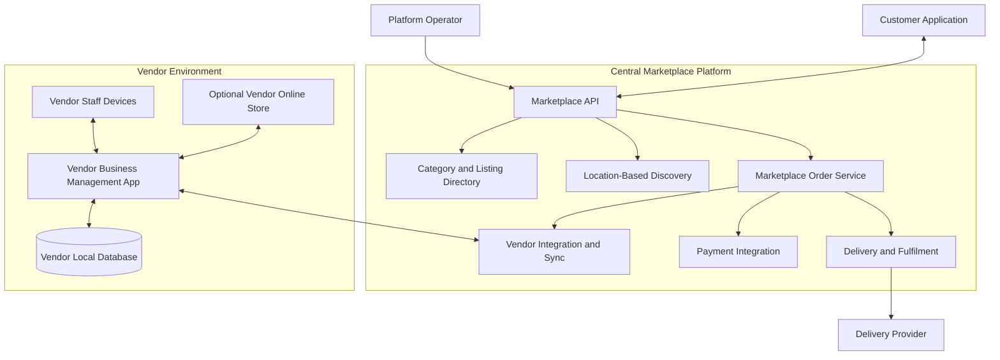
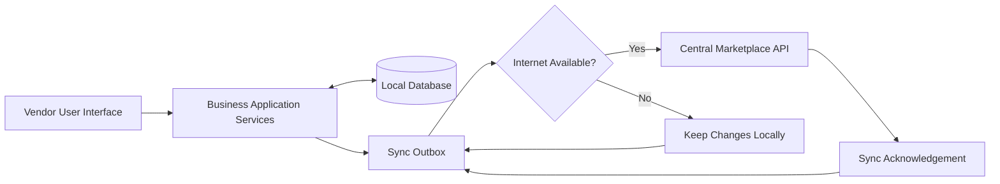
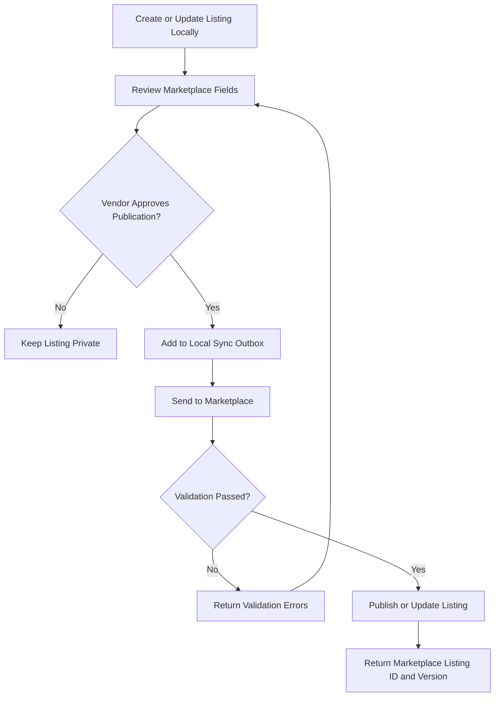
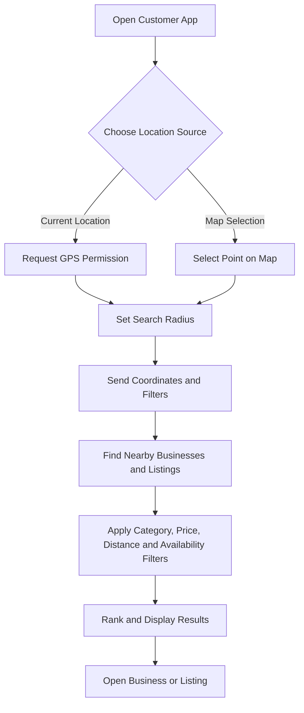
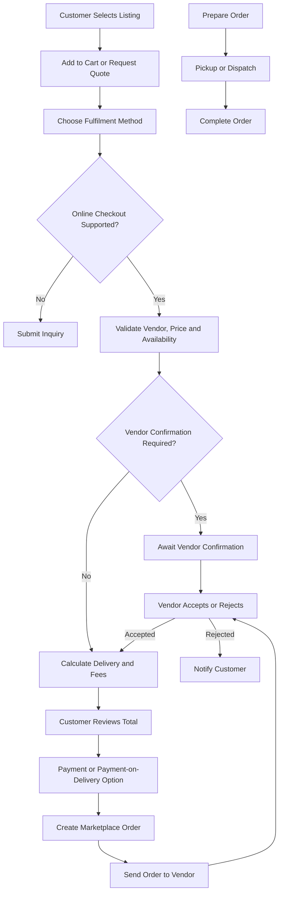
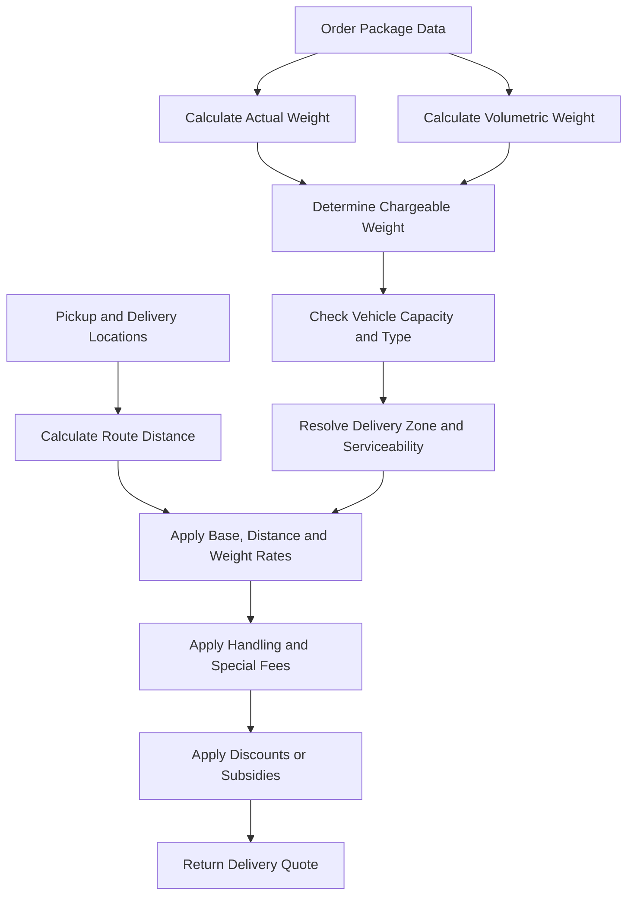
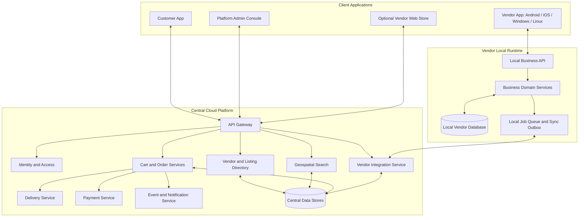

# Location-Based Multi-Vendor Commerce and Business Networking Platform
---

## 1. Executive Summary

This document describes a location-based, multi-vendor commerce and business networking platform. It connects independent shops, service providers, customers, and the platform operator through three principal applications:

1. **Vendor Business Management Application** — a local-first business management system that allows a vendor to operate its business independently, including when internet connectivity is unavailable.
2. **Central Marketplace Platform** — a shared online discovery and commerce platform where vendors can publish approved products, services, and business listings.
3. **Customer Application** — a location-aware application through which customers can discover nearby businesses, compare offers, visit physical shops, or place online orders for delivery.

The platform is designed around vendor independence. Each vendor owns and operates its local business environment. The central marketplace does not replace the vendor's local system and does not automatically take ownership of the vendor's entire product catalogue. A vendor explicitly selects which products or listings may be published to the marketplace.

The platform supports both physical and online commerce. It can also support a broader business directory across multiple industries, using the supplied 20-category taxonomy. Not every category represents a shippable product: the listing model must distinguish physical goods, services, properties, digital offerings, events, and business profiles.

---

## 2. Product Vision and Objectives

### 2.1 Vision

Create a connected local-business ecosystem in which independent vendors can manage their businesses locally while participating in a shared, location-aware marketplace when they choose to do so.

### 2.2 Strategic Objectives

- Enable independent vendors to digitize and manage their businesses without depending on a permanent internet connection.
- Allow vendors to publish selected products and services to a central marketplace.
- Help customers discover relevant businesses and offerings around their current or selected location.
- Support in-store visits, pickup, delivery, and other fulfilment methods where applicable.
- Provide transparent order, inventory, pricing, and synchronization workflows.
- Support multiple business sectors through a configurable category and listing-type model.
- Allow the platform to generate revenue through vendor subscriptions, transaction services, optional promotion, and other clearly disclosed services.

### 2.3 Core Principles

| Principle | Requirement |
|---|---|
| Vendor autonomy | The vendor's local business system remains independently usable. |
| Local-first operation | Core business operations must continue during internet outages. |
| Explicit publication | Only vendor-approved records are published to the central marketplace. |
| Data ownership | Vendor operational data remains under the vendor's control, subject to applicable agreements and law. |
| Location relevance | Discovery can use GPS or a customer-selected map point and search radius. |
| Listing-type awareness | Physical goods, services, properties, digital items, and business profiles must not be treated as identical. |
| Synchronization safety | Updates must be versioned, traceable, retryable, and conflict-aware. |
| Transparent fulfilment | Delivery eligibility, fees, and estimated times must be shown before order confirmation. |

---

## 3. Business Model and Ecosystem

### 3.1 Main Participants

- **Platform Operator:** Operates the central marketplace, identity services, platform policies, integrations, and platform-level administration.
- **Vendor / Shop Owner:** Owns a business, manages its local operations, and decides what information to publish.
- **Vendor Staff:** Uses permitted parts of the vendor application under role-based access control.
- **Customer:** Discovers businesses and listings, places orders, chooses fulfilment, and manages their own account.
- **Delivery Provider:** Performs delivery where the platform or vendor offers a delivery service.
- **Optional Service Partners:** Payment providers, mapping/geocoding providers, messaging providers, and other approved integrations.

### 3.2 Ecosystem Diagram

### 3.3 Three Product Surfaces

#### A. Vendor Business Management Application

A cross-platform application intended for Android, iOS, Windows, and Linux. It connects to a local server/database environment and provides business operations such as:

- Business profile and branch management
- Product and service catalogue
- Product variants, units, pricing, and tax configuration
- Inventory and stock movements
- Purchasing and supplier management
- Sales, invoices, receipts, and returns
- Customer management
- Staff accounts, roles, and permissions
- Cash, expenses, and basic accounting workflows
- Reports and business analytics
- Optional online store publishing
- Optional central marketplace integration

The exact modules enabled for a vendor may depend on its business type, subscription, and configuration.

#### B. Central Marketplace Platform

The central platform provides shared services:

- Vendor registration and business verification
- Business and branch directory
- Category and listing taxonomy
- Search and location-based discovery
- Public product/service listings
- Marketplace cart and order management
- Payment orchestration, where enabled
- Delivery and fulfilment coordination
- Vendor integration APIs
- Moderation, abuse reporting, and platform administration
- Platform analytics and revenue management

#### C. Customer Application

The customer application provides:

- Account and profile management
- GPS-based or map-point-based location selection
- Search radius selection
- Nearby business and listing discovery
- Category, price, availability, and distance filters
- Business profile and opening-hours view
- Product or service details
- Cart and checkout for eligible listings
- Pickup, in-store purchase, or delivery options
- Order tracking and order history
- Ratings, reviews, and support workflows

---

## 4. Vendor Business Management Model

### 4.1 Local-First Operating Model

The vendor application must be useful without the central marketplace. A local installation should be able to continue normal business operations when the internet is unavailable.

### 4.2 Local Data Ownership

The local database is the authoritative source for the vendor's operational data, including:

- Product master records
- Product variants and local prices
- Stock balances and stock movements
- Purchase and sales transactions
- Customer and supplier records
- Staff and permissions
- Local invoices and receipts
- Local configuration

The marketplace receives only the fields and records required for the vendor-approved publication and marketplace transaction workflows.

### 4.3 Optional Capabilities

These capabilities are independent and should be enabled separately:

1. **Personal Online Store:** The vendor publishes a dedicated online storefront.
2. **Marketplace Integration:** The vendor connects to the shared marketplace and chooses which listings to publish.
3. **Remote Administration:** An authorized user connects to the vendor environment remotely through a secured connection, if enabled.
4. **Companion Frontend:** Additional devices connect to the vendor's local server as user interfaces rather than maintaining separate authoritative business databases.

### 4.4 Multi-User Access

The vendor system should support multiple staff members and devices. Access must be controlled by roles and permissions, for example:

- Owner / Administrator
- Branch Manager
- Sales Operator
- Inventory Operator
- Purchase Operator
- Accountant
- Read-only Auditor

Permissions should be granular enough to control actions such as viewing cost prices, changing selling prices, approving discounts, editing stock, cancelling orders, issuing refunds, and exporting reports.

---

## 5. Marketplace Publication and Synchronization

### 5.1 Explicit Publication Workflow

A vendor must explicitly approve a product or listing before it becomes publicly visible on the central marketplace.

### 5.2 Publication Controls

Each publishable record should include or resolve to:

- Vendor ID
- Branch or fulfilment location ID
- Local record ID
- Marketplace listing ID, once assigned
- Listing type
- Category and subcategory
- Public title and description
- Public images and media references
- Public price or quote configuration
- Availability and publication status
- Delivery/pickup eligibility
- Publication consent and approval timestamp
- Record version and last-modified timestamp

Sensitive local fields must not be copied to public marketplace records unless explicitly required and authorized.

### 5.3 Synchronization Requirements

- Use a durable local outbox so changes are not lost when connectivity fails.
- Assign stable identifiers to local records.
- Use idempotency keys for retried requests.
- Track local version and marketplace version.
- Record sync status, last attempt, last successful sync, and error details.
- Retry transient failures with bounded exponential backoff.
- Provide a manual retry and sync-status interface.
- Support unpublishing and deletion/tombstone events.
- Preserve an audit trail of publication and synchronization actions.

### 5.4 Conflict Handling

The platform must not silently overwrite a newer vendor price or stock value with stale marketplace data.

Recommended rules:

- Vendor local system is authoritative for vendor-managed product data and stock.
- Marketplace orders are authoritative for marketplace order lifecycle events.
- The vendor application must validate current stock and price before accepting an online order.
- If the local system is offline, the marketplace may accept an order request only under an explicitly configured reservation policy; otherwise, show the order as awaiting vendor confirmation.
- Conflicts must be visible and resolvable, not silently discarded.

---

## 6. Business Directory, Listings, and Product Classification

### 6.1 Taxonomy Source

The supplied `Category.json` defines **20 top-level categories** with nested subcategories and items. It includes both commerce-oriented categories and broad business/service/community domains.

The taxonomy is a discovery and classification structure. It is not, by itself, a complete product data model.

### 6.2 Listing Types

The platform should distinguish at least the following listing types:

| Listing type | Examples | Typical transaction model |
|---|---|---|
| Physical product | Grocery, electronics, clothing, machinery | Fixed price, stock, delivery/pickup |
| Service | Repair, consulting, healthcare, education | Fixed fee, quote, appointment/request |
| Property | Apartment, land, commercial space | Sale, rent, inquiry, viewing |
| Digital product | Software, digital content | Fixed price, download/access |
| Event or experience | Concert, class, tour | Ticket, booking, registration |
| Business profile | Hospital, school, public service, association | Discovery, contact, inquiry |
| Recyclable / used goods | Scrap, used electronics, second-hand furniture | Fixed price, negotiated price, auction |

A listing's type determines which fields, filters, fulfilment rules, and checkout flows are available.

### 6.3 Product Data Versus Business Data

A business profile represents the vendor or service provider. A listing represents something that business offers. One business may have many listings and may operate multiple branches.

Do not create a separate vendor account for every product or service. Do not force a non-commercial directory entry into a product inventory schema.

### 6.4 Taxonomy Governance

- Preserve the source category IDs as stable external identifiers.
- Store category names separately from vendor listing data.
- Support future taxonomy versions and deprecation without breaking existing records.
- Allow aliases and searchable keywords without changing canonical IDs.
- Validate category/subcategory/item relationships.
- Permit a listing to have one primary category and, where useful, secondary tags.
- Record the taxonomy version used when a listing is classified.

---

## 7. Location-Based Discovery

### 7.1 Customer Location Selection

Customers can search using either:

1. Current device GPS location, after permission is granted; or
2. A location manually selected on a map.

The customer then selects a search radius. The platform searches eligible published listings and businesses within the requested geographic area.

### 7.2 Discovery Workflow

### 7.3 Search Filters

Potential filters include:

- Category and subcategory
- Listing type
- Distance
- Price range
- Open now / opening hours
- In-stock / available
- Delivery available
- Pickup available
- Vendor rating
- Brand, attributes, and product variants
- Service area or appointment availability

### 7.4 Ranking

Search ranking may consider:

- Geographic distance
- Text relevance
- Category match
- Availability
- Vendor quality signals
- Customer-selected sorting
- Paid promotion, if used, clearly labeled as sponsored

The system should not present sponsored placement as an organic relevance result.

---

## 8. Customer Purchase and Order Management

### 8.1 Supported Purchase Paths

- **Visit Store:** Customer discovers a shop and completes the purchase physically.
- **Pickup:** Customer places an order and collects it from the vendor.
- **Delivery:** Customer places an eligible online order for delivery to an accepted address.
- **Inquiry / Quote:** Used for services, properties, bulk orders, or listings without a fixed checkout price.

### 8.2 Marketplace Order Flow

### 8.3 Order Status Model

A suggested order state model:

- Draft
- Submitted
- Awaiting Vendor Confirmation
- Accepted
- Rejected
- Awaiting Payment
- Paid
- Preparing
- Ready for Pickup
- Dispatched
- Delivered
- Completed
- Cancelled
- Refund Requested
- Partially Refunded
- Refunded

Not every fulfilment type uses every status. State transitions must be validated by the order service.

### 8.4 Inventory Reservation

Inventory reservation should be configurable:

- **Strict confirmation:** Do not reserve stock until the vendor confirms.
- **Temporary reservation:** Reserve stock for a limited checkout period.
- **Local real-time validation:** Vendor local server validates stock while online.
- **Offline pending mode:** Accept a request but mark it pending until vendor confirmation.

The platform must not claim guaranteed stock when it has only a stale marketplace snapshot.

---

## 9. Delivery and Fulfilment Cost Model

### 9.1 Required Inputs

Delivery cost may depend on:

- Pickup and destination coordinates
- Route distance, not merely straight-line distance
- Actual package weight
- Package dimensions
- Volumetric weight
- Package count
- Vehicle type and capacity
- Delivery zone
- Base fare and per-distance charge
- Handling, fragile, cold-chain, or special-service fees
- Waiting time, tolls, or other configured surcharges
- Vendor subsidy, platform subsidy, or promotional discount

### 9.2 Volumetric Weight

A common volumetric-weight model is:

\[
W_v = \frac{L \times W \times H}{K}
\]

Where:

- \(L\), \(W\), and \(H\) are package dimensions in the configured unit.
- \(K\) is the carrier's volumetric divisor.
- \(W_v\) is volumetric weight in the corresponding weight unit.

Chargeable weight is commonly:

\[
W_c = \max(W_a, W_v)
\]

Where \(W_a\) is actual weight. The divisor, units, rounding rules, and minimum charge must be configurable by carrier and service type.

### 9.3 Delivery Cost Pipeline

### 9.4 Vehicle Capacity and Eligibility

The delivery service should reject or split assignments that exceed vehicle capacity. Vehicle selection may depend on:

- Maximum payload weight
- Maximum package volume
- Package dimensions
- Number of packages
- Vehicle availability
- Road and zone restrictions
- Temperature-control or special handling requirements

A delivery quote must identify its validity period. If the cart, destination, package data, or rate configuration changes, the quote should be recalculated.

### 9.5 Quote Transparency

Before order confirmation, show the customer:

- Delivery method
- Estimated distance or delivery zone
- Chargeable weight basis, where appropriate
- Delivery fee
- Additional fees
- Discounts/subsidies
- Estimated delivery window
- Quote expiry or conditions

---

## 10. Functional Module Catalogue

### 10.1 Vendor Application

| Module | Core capabilities |
|---|---|
| Business Setup | Business profile, branches, operating hours, tax and currency settings |
| Users and Permissions | Staff accounts, roles, permissions, audit trail |
| Catalogue | Products, services, variants, categories, images, attributes |
| Inventory | Stock, warehouses, transfers, adjustments, low-stock alerts |
| Purchasing | Suppliers, purchase orders, receiving, purchase returns |
| Sales and POS | Sales, cart, discounts, invoices, receipts, returns |
| Customers | Customer profiles, contact records, transaction history |
| Finance | Cash accounts, expenses, income, payment records, summaries |
| Reports | Sales, stock, purchases, profit summaries, staff activity |
| Online Store | Storefront settings, public catalogue, order presentation |
| Marketplace Integration | Vendor linking, publication approval, synchronization status |
| Configuration | Devices, printers, backups, data export, system settings |

### 10.2 Central Platform

| Module | Core capabilities |
|---|---|
| Identity and Access | Customer/vendor accounts, authentication, session management |
| Vendor Onboarding | Registration, business verification, branch setup |
| Business Directory | Public business profiles and locations |
| Taxonomy | Categories, subcategories, listing types, tags |
| Listing Management | Published products, services, property and other listings |
| Search and Discovery | Geospatial search, filters, ranking |
| Cart and Checkout | Cart validation, checkout, quote generation |
| Order Management | Order lifecycle, vendor acceptance, cancellation |
| Payments | Payment provider integration and reconciliation |
| Delivery | Serviceability, rates, dispatch, tracking |
| Integration API | Vendor authentication, sync, webhooks |
| Moderation | Reports, review queues, policy enforcement |
| Platform Administration | Configuration, support, analytics, revenue reporting |

### 10.3 Customer Application

| Module | Core capabilities |
|---|---|
| Account | Profile, addresses, preferences |
| Location | GPS, map selection, saved locations, radius |
| Discovery | Nearby businesses and listings |
| Search | Text search, category filters, sorting |
| Business Detail | Branch, hours, contact, facilities |
| Listing Detail | Price, variants, availability, delivery eligibility |
| Cart and Checkout | Cart, fulfilment, fees, order confirmation |
| Orders | Status, history, cancellation and support |
| Reviews | Ratings, reviews, issue reporting |
| Notifications | Order updates, vendor messages, service alerts |

---

## 11. High-Level Technical Architecture

### 11.1 Logical Architecture

### 11.2 Deployment Boundaries

- Vendor local runtime is deployed in the vendor's environment.
- Central marketplace services are deployed and operated by the platform operator.
- Customer and administration applications communicate with central APIs.
- Vendor applications communicate with the local runtime and, when enabled, with central integration APIs.
- A remote access gateway may be added, but it must not expose the local database directly to the public internet.

### 11.3 Suggested Service Boundaries

Start with a modular architecture and separate deployable services only when operational scale requires it. Suggested logical domains:

- Identity and Access
- Vendor and Branch Management
- Catalogue and Taxonomy
- Search and Geospatial Discovery
- Marketplace Orders
- Vendor Synchronization
- Payments
- Delivery and Fulfilment
- Notifications
- Moderation and Administration

---

## 12. Data Architecture

### 12.1 Data Ownership Boundaries

| Data domain | Primary authority | Central platform copy |
|---|---|---|
| Vendor internal product master | Vendor local system | Approved public projection only |
| Vendor internal stock ledger | Vendor local system | Availability snapshot or reservation state |
| Purchase and supplier records | Vendor local system | Not copied unless a specific feature requires it |
| Local sales and cash records | Vendor local system | Marketplace transaction references and required settlement data |
| Public business profile | Vendor-approved data, platform verification | Yes |
| Public marketplace listing | Vendor-approved publication | Yes |
| Marketplace order | Central marketplace | Vendor receives operational order copy |
| Delivery assignment and tracking | Delivery service/provider | Yes, as needed for customer and vendor visibility |
| Customer account | Central platform | Shared with vendor only to the extent required for an order and permitted |

### 12.2 Suggested Core Entities

**Vendor environment:**

- `businesses`
- `branches`
- `users`
- `roles`
- `permissions`
- `user_role_assignments`
- `products`
- `product_variants`
- `product_attributes`
- `product_attribute_values`
- `units`
- `price_lists`
- `warehouses`
- `stock_balances`
- `stock_movements`
- `suppliers`
- `purchase_orders`
- `purchase_order_items`
- `sales`
- `sale_items`
- `customers`
- `payments`
- `expenses`
- `sync_outbox`
- `sync_attempts`
- `audit_logs`

**Central platform:**

- `platform_users`
- `vendors`
- `vendor_branches`
- `vendor_memberships`
- `categories`
- `subcategories`
- `taxonomy_items`
- `taxonomy_versions`
- `business_profiles`
- `listings`
- `listing_media`
- `listing_publications`
- `listing_availability`
- `customer_addresses`
- `search_locations` or geospatial index
- `carts`
- `cart_items`
- `marketplace_orders`
- `marketplace_order_items`
- `order_status_events`
- `payment_transactions`
- `delivery_quotes`
- `delivery_assignments`
- `delivery_rate_cards`
- `vehicle_types`
- `vendor_sync_devices`
- `sync_events`
- `reviews`
- `reports`
- `moderation_cases`

These are logical entity suggestions, not a final physical schema. Column definitions, indexes, constraints, and database technology should be finalized during detailed design.

### 12.3 Identifier Strategy

Use globally unique IDs for central records and stable vendor-scoped identifiers for local records. Every synchronized listing should carry a mapping between:

- Vendor ID
- Local entity type
- Local entity ID
- Central entity ID
- Local version
- Central version

Avoid relying on auto-increment integers as globally unique identifiers across independent vendor installations.

---

## 13. API and Integration Design

### 13.1 API Groups

Suggested API domains:

- `/auth`
- `/vendors`
- `/branches`
- `/categories`
- `/listings`
- `/publications`
- `/search`
- `/carts`
- `/orders`
- `/payments`
- `/delivery-quotes`
- `/delivery-assignments`
- `/sync`
- `/notifications`
- `/reviews`

### 13.2 Example Synchronization Contract

A publication request should contain:

- Vendor and branch identity
- Local entity ID and entity type
- Local version
- Listing type and taxonomy references
- Approved public fields
- Publication action (`publish`, `update`, or `unpublish`)
- Idempotency key
- Timestamp

The response should contain:

- Accepted/rejected result
- Central listing ID
- Central version
- Validation errors, if any
- Sync event ID
- Server timestamp

### 13.3 Webhooks and Events

The central platform may notify vendor systems about:

- New marketplace order
- Order cancellation
- Payment status change
- Customer message
- Listing moderation outcome
- Publication rejection
- Delivery status update

Webhook delivery must be authenticated, signed, retryable, and deduplicated. Vendor systems must be able to recover missed events through an authenticated event pull or synchronization endpoint.

---

## 14. Security, Privacy, and Trust

### 14.1 Security Controls

- Encrypt network traffic using TLS.
- Use secure authentication and short-lived access tokens.
- Enforce role-based and action-level authorization.
- Store credentials and secrets securely.
- Encrypt sensitive local and central data at rest where appropriate.
- Keep audit records for sensitive operations.
- Rate-limit public and integration APIs.
- Validate uploaded files and media.
- Use signed webhooks and idempotency keys.
- Back up vendor local data and test restoration.
- Avoid exposing local database ports to the public internet.

### 14.2 Privacy Controls

- Request location permission only when needed.
- Allow manual location selection when GPS is unavailable or declined.
- Explain how location is used for nearby discovery and delivery estimation.
- Share customer details with vendors only when required for a transaction or explicitly authorized.
- Do not publish vendor-private fields.
- Provide account, listing, and data-retention controls consistent with applicable law.

### 14.3 Trust and Moderation

- Vendor verification levels
- Business and listing reporting
- Review moderation
- Duplicate and misleading listing detection
- Restricted-category policies
- Clear sponsored-listing labels
- Dispute and refund workflows
- Transparent vendor and customer terms

---

## 15. Non-Functional Requirements

| Area | Requirement |
|---|---|
| Offline operation | Core vendor operations continue without internet. |
| Reliability | Local transactions must be durable and recoverable. |
| Synchronization | Retries, idempotency, versioning, and conflict visibility are required. |
| Performance | Nearby search and catalogue browsing should be optimized for pagination and indexed filters. |
| Scalability | Central services should support growth in vendors, branches, listings, and concurrent customers. |
| Availability | Central platform availability must be monitored; local vendor operations must not depend on it. |
| Security | Authentication, authorization, encryption, audit logging, and secure backups are required. |
| Accessibility | Customer and vendor applications should support accessible navigation and readable content. |
| Localization | Support configurable language, currency, units, date, and number formats. |
| Observability | Central services and local sync agents should expose structured logs, metrics, and trace identifiers. |
| Maintainability | Use modular domain boundaries and versioned APIs. |

---

## 16. Revenue Model

Potential revenue streams include:

1. **Vendor Subscription:** Tiered plans for business management, branches, staff seats, reporting, and advanced features.
2. **Marketplace Commission:** A disclosed fee on eligible completed marketplace transactions.
3. **Promoted Listings:** Paid visibility with clear sponsored labels.
4. **Optional Add-on Services:** Advanced analytics, additional storage, custom storefronts, or integration services.
5. **Delivery Service Margin:** A disclosed service margin where the platform arranges delivery.
6. **Enterprise Plans:** Custom plans for chains, wholesalers, distributors, and multi-branch businesses.

Revenue rules should be configurable by region, vendor plan, listing type, and transaction type. The platform should avoid charging vendors for transactions that did not meet the agreed billable event definition.

---

## 17. Operational Administration

Platform administration should include:

- Vendor onboarding and verification
- Vendor suspension and reinstatement
- Category and taxonomy management
- Listing moderation
- Customer support and dispute handling
- Payment reconciliation
- Delivery partner and rate-card configuration
- Subscription and commission configuration
- Fraud and abuse monitoring
- Service health and integration monitoring
- Audit and compliance reporting

Vendor administration should include:

- Local backup and restore
- Staff and permission management
- Branch and device management
- Sync health and retry controls
- Publication approvals
- Order acceptance and fulfilment
- Export of vendor-owned business data

---

## 18. Delivery Roadmap

### Phase 1 — Foundation

- Confirm product scope and listing types.
- Finalize vendor, branch, customer, and identity models.
- Implement vendor local runtime and local database.
- Implement vendor setup, users, roles, and permissions.
- Implement core catalogue and business profile.

### Phase 2 — Vendor Operations

- Implement inventory, purchasing, sales, customers, and basic finance.
- Add invoices, receipts, returns, and reports.
- Add local backup and restore.
- Validate offline workflows.

### Phase 3 — Central Marketplace

- Implement vendor onboarding and public business profiles.
- Import and version the taxonomy.
- Implement listing publication and moderation.
- Implement geospatial discovery and customer search.

### Phase 4 — Synchronization

- Implement local outbox and central integration API.
- Add versioning, retries, idempotency, and conflict handling.
- Add sync dashboard and operational monitoring.
- Test internet loss, duplicate requests, stale data, and recovery.

### Phase 5 — Customer Commerce

- Implement cart, checkout, order lifecycle, and vendor confirmation.
- Add pickup and delivery options.
- Add payment integration where required.
- Add customer notifications and order history.

### Phase 6 — Delivery Intelligence

- Implement delivery zones, route distance, weight and volumetric calculations.
- Add vehicle type and capacity checks.
- Add delivery partner integration and tracking.
- Add quote expiry and rate-card management.

### Phase 7 — Expansion

- Add optional vendor storefronts and remote administration.
- Add more listing types and category-specific workflows.
- Add subscriptions, commissions, promotions, and advanced analytics.
- Scale infrastructure based on measured load and operational requirements.

---

## 19. Key Risks and Mitigations

| Risk | Impact | Mitigation |
|---|---|---|
| Stale marketplace stock | Customer orders unavailable goods | Vendor confirmation, stock freshness indicators, reservation policy |
| Conflicting price updates | Incorrect checkout totals | Vendor-authoritative pricing, version checks, checkout revalidation |
| Internet outage | Marketplace sync delayed | Durable local outbox and retry mechanism |
| Duplicate sync requests | Duplicate listings or orders | Idempotency keys and unique constraints |
| Incorrect delivery estimate | Customer dissatisfaction and cost loss | Configurable rate cards, route distance, package data validation |
| Taxonomy ambiguity | Poor search and incorrect listing workflows | Listing types, taxonomy governance, category-specific validation |
| Vendor data exposure | Privacy and trust failure | Explicit publication, field allowlists, authorization, audit |
| Overly broad initial scope | Delayed launch | Phased delivery and measurable acceptance criteria |
| Unsafe remote access | Local business compromise | Secure gateway, no public database exposure, MFA where available |

---

## 20. Key Product Decisions to Finalize

The following decisions remain product-owner choices and should be confirmed before detailed implementation:

1. Whether the central marketplace supports direct payment, cash on delivery, vendor-collected payment, or a configurable combination.
2. Whether marketplace orders require vendor confirmation by default.
3. Whether each vendor can operate multiple branches and warehouses from the first release.
4. Whether delivery is platform-managed, vendor-managed, third-party-managed, or configurable per order.
5. Whether service listings support appointments and bookings in the first release or only inquiry/quote workflows.
6. Whether used goods and auctions are included in the initial release.
7. Which vendor application platforms are delivered in the first release.
8. Which country-specific tax, payment, consumer protection, and data-protection requirements apply at launch.

---

## 21. Acceptance Criteria

The first production-ready release should demonstrate that:

- A vendor can create and operate a business locally without internet access.
- Authorized staff can use the vendor application with role-based permissions.
- A vendor can explicitly select and publish a listing.
- Only approved public fields are sent to the central marketplace.
- A customer can search using GPS or a selected map point and radius.
- Search results respect listing type, category, location, and publication status.
- An eligible customer can submit an order or inquiry.
- The vendor can receive and process marketplace orders.
- Stock and price are revalidated according to the configured confirmation policy.
- Delivery quotes account for route distance, actual/volumetric weight, vehicle capacity, and delivery zones where delivery is enabled.
- Sync survives internet interruptions and safely retries without duplicating records.
- Vendor-private operational records are not unintentionally exposed to the marketplace.
- Administrators can monitor vendors, listings, orders, sync failures, and platform operations.

---

## Appendix A — Category Taxonomy from `Category.json`

The following hierarchy is transcribed programmatically from the supplied source file. Names and IDs are retained as provided. Where the source uses nested `groups`, they are shown as groups rather than silently flattened into subcategories.

### 1. Transport & Logistics
- **1.1 — Road Transport**
  - Bus & Coach; Truck & Freight; Car & Taxi; Motorcycle; Bicycle; Rickshaw & CNG
- **1.2 — Rail Transport**
  - Passenger Train; Metro & Subway; Tram; Freight Rail
- **1.3 — Air Transport**
  - Passenger Airline; Cargo Airline; Helicopter; Drone
- **1.4 — Water Transport**
  - Cargo Ship; Passenger Ferry; Fishing Boat; Port & Harbor
- **1.5 — Public Transport**
  - City Bus; Metro Service; Ride Sharing; School Transport
- **1.6 — Freight & Cargo**
  - Courier Service; Trucking; Container Shipping; Air Freight
- **1.7 — Warehousing & Storage**
  - Cold Storage; General Warehouse; Distribution Center; Bonded Warehouse
- **1.8 — Electric Vehicles**
  - EV Car; EV Bike; Charging Station; Battery Swapping
- **1.9 — Pipeline Transport**
  - Oil Pipeline; Gas Pipeline; Water Pipeline

### 2. Food & Beverage
- **2.1 — Fruits & Vegetables**
  - Fresh Fruits; Fresh Vegetables; Dried Fruits; Frozen Vegetables
- **2.2 — Meat & Poultry**
  - Beef; Mutton; Chicken; Duck; Processed Meat
- **2.3 — Seafood**
  - Fish; Shrimp & Prawn; Crab; Dry Fish
- **2.4 — Dairy & Eggs**
  - Milk; Cheese; Butter & Ghee; Yogurt; Eggs
- **2.5 — Grains & Cereals**
  - Rice; Wheat & Flour; Corn; Oats & Barley
- **2.6 — Spices & Condiments**
  - Whole Spices; Ground Spices; Sauces & Ketchup; Salt & Sugar
- **2.7 — Beverages**
  - Tea; Coffee; Juice; Soft Drinks; Alcohol
- **2.8 — Snacks & Confectionery**
  - Chips & Biscuits; Chocolate; Candy; Bakery Items
- **2.9 — Processed & Packaged Food**
  - Canned Food; Ready-to-Eat; Frozen Food; Instant Noodles
- **2.10 — Organic & Health Food**
  - Organic Produce; Superfoods; Supplements; Gluten-Free
- **2.11 — Fast Food & Restaurant**
  - Burger & Pizza; Street Food; Catering; Cloud Kitchen
- **2.12 — Food Safety**
  - Certification; Hygiene Inspection; Packaging Standards

### 3. Education & Training
- **3.1 — Preschool & Kindergarten**
  - Playgroup; Nursery; KG
- **3.2 — Primary Education**
  - Grade 1-5; Madrasa Primary
- **3.3 — Secondary Education**
  - Grade 6-10; SSC & O-Level; Vocational Secondary
- **3.4 — Higher Education**
  - College; University; Research Institute
- **3.5 — Vocational & Technical**
  - Trade Course; Polytechnic; IT Training
- **3.6 — Online Education**
  - E-learning Platform; MOOC; Virtual Classroom
- **3.7 — Special Education**
  - Disability Support; Special Needs School
- **3.8 — Adult Education**
  - Literacy Program; Continuing Education
- **3.9 — Scholarships & Aid**
  - Government Scholarship; Private Grant; Student Loan
- **3.10 — Curriculum & Assessment**
  - Syllabus Design; Exam Board; Certification
- **3.11 — Teacher Training**
  - B.Ed; Professional Development
- **3.12 — Skill Development**
  - Soft Skills; Technical Skills; Language Course

### 4. Service Industry
- **4.1 — Customer Service**
  - Call Center; Help Desk; Complaint Management
- **4.2 — Financial Services**
  - Banking; Insurance; Investment; Microfinance
- **4.3 — Hospitality**
  - Hotel; Restaurant; Travel Agency; Event Management
- **4.4 — Healthcare Services**
  - Hospital Service; Diagnostic Center; Home Care; Ambulance
- **4.5 — IT & Software Services**
  - Web Development; App Development; IT Support; Cloud Service
- **4.6 — Repair & Maintenance**
  - Appliance Repair; Vehicle Repair; Electronics Repair; Home Maintenance
- **4.7 — Cleaning & Facility**
  - House Cleaning; Office Cleaning; Pest Control; Security Service
- **4.8 — Legal Services**
  - Lawyer & Attorney; Notary; Legal Consultancy; Arbitration
- **4.9 — Consulting & Advisory**
  - Business Consulting; Management Consulting; HR Consulting
- **4.10 — Government Services**
  - Civil Service; Municipal Service; Public Utility
- **4.11 — Personal Services**
  - Salon & Spa; Laundry; Photography; Event Planning
- **4.12 — Logistics Services**
  - Courier; Freight Forwarding; Customs Clearing
- **4.13 — Matchmaking & Wedding Service**
  - **Matchmaking Agency**
    - Traditional Matchmaker; Online Matrimonial Platform; Community Matchmaker; Elite & Premium Matchmaking
  - **Profile & Verification**
    - Biodata Creation; Photo & Video Profile; Background & Family Verification; Education & Career Verification; Health & Medical Report
  - **Compatibility Matching**
    - Age & Height Matching; Education & Profession Matching; Religion & Community Matching; Family Status Matching; Horoscope & Kundli Matching; Lifestyle & Interest Matching
  - **Wedding Planning**
    - Venue Booking; Catering & Menu; Decoration & Stage; Wedding Photography & Videography; Bridal Makeup & Styling; Wedding Invitation & Card; Wedding Planner & Coordinator
  - **Wedding Rituals & Culture**
    - Engagement; Holud & Gaye Holud; Nikah & Religious Ceremony; Reception; Wedding Dress & Jewelry
  - **Post-Marriage Support**
    - Couple Counseling; Legal Marriage Registration; Honeymoon Package
- **4.14 — Second-hand Goods Service**
  - **Buying Service**
    - Used Goods Buying with Home Pickup; Valuation & Pricing; Bulk Purchase for Hotel & Office
  - **Selling Service**
    - Consignment Sale; Online Listing Service; Photography & Ad Creation
  - **Repair & Refurbish**
    - Electronics Repair; Furniture Restoration; Vehicle Detailing
  - **Auction & Bidding**
    - Online Auction; Live Auction; Estate Sale
  - **Delivery & Logistics**
    - Pickup Service; Home Delivery; Installation Service

### 5. Raw Materials & Resources
- **5.1 — Metals**
  - Iron & Steel; Copper; Aluminum; Gold & Silver
- **5.2 — Minerals & Mining**
  - Coal; Limestone; Gypsum; Graphite
- **5.3 — Timber & Wood**
  - Hardwood; Softwood; Plywood; Bamboo
- **5.4 — Cotton & Textiles**
  - Raw Cotton; Yarn; Jute Fiber; Synthetic Fiber
- **5.5 — Crude Oil & Petroleum**
  - Crude Oil; Diesel; Petrol; Lubricant
- **5.6 — Natural Gas**
  - LPG; CNG; LNG
- **5.7 — Rubber**
  - Natural Rubber; Synthetic Rubber
- **5.8 — Industrial Chemicals**
  - Acid & Alkali; Solvents; Polymers; Dyes & Pigments
- **5.9 — Petrochemicals**
  - Plastic Resin; Ethylene; Propylene
- **5.10 — Stone, Sand & Cement**
  - River Sand; Crushed Stone; Cement; Brick
- **5.11 — Agricultural Raw Materials**
  - Jute; Leather; Raw Hide; Tobacco Leaf
- **5.12 — Water Resources**
  - Groundwater; Surface Water; Desalinated Water

### 6. Machinery & Equipment
- **6.1 — Industrial Machinery**
  - Manufacturing Machine; Packaging Machine; Welding Machine
- **6.2 — Agricultural Machinery**
  - Tractor; Harvester; Plough; Irrigation Pump
- **6.3 — Construction Equipment**
  - Excavator; Bulldozer; Crane; Concrete Mixer
- **6.4 — Electrical Machinery**
  - Generator; Transformer; Motor; Switchgear
- **6.5 — Medical Equipment**
  - Diagnostic Machine; Surgical Instrument; Imaging Equipment
- **6.6 — Mining Machinery**
  - Drill Machine; Crusher; Conveyor
- **6.7 — Textile Machinery**
  - Spinning Machine; Loom; Dyeing Machine
- **6.8 — Heavy Equipment & Vehicles**
  - Loader; Forklift; Dump Truck
- **6.9 — Tools & Spare Parts**
  - Hand Tools; Power Tools; Bearings & Gears
- **6.10 — Robotics & Automation**
  - Industrial Robot; CNC Machine; PLC System
- **6.11 — 3D Printing**
  - 3D Printer; Filament; Prototyping Service

### 7. Properties & Real Estate
- **7.1 — Residential**
  - Apartment; House; Duplex; Hostel
- **7.2 — Commercial**
  - Office Space; Shop; Shopping Mall; Showroom
- **7.3 — Industrial**
  - Factory Building; Warehouse; Workshop
- **7.4 — Agricultural Land**
  - Farmland; Orchard; Tea Garden
- **7.5 — Land & Plots**
  - Residential Plot; Commercial Plot; Industrial Plot
- **7.6 — Rental Properties**
  - Residential Rent; Commercial Rent; Short-term Rent
- **7.7 — Real Estate Investment**
  - REIT; Property Fund; Land Banking
- **7.8 — Vacation Properties**
  - Resort; Holiday Home; Guest House
- **7.9 — Property Management**
  - Maintenance; Tenant Management; Valuation
- **7.10 — Construction & Development**
  - Developer; Contractor; Real Estate Agency

### 8. Culture & Heritage
- **8.1 — Art & Painting**
  - Fine Art; Digital Art; Sculpture; Calligraphy
- **8.2 — Music**
  - Classical; Folk; Modern & Pop; Instrumental
- **8.3 — Dance**
  - Classical Dance; Folk Dance; Modern Dance
- **8.4 — Literature & Books**
  - Fiction; Non-fiction; Poetry; Children's Book
- **8.5 — Theater & Drama**
  - Stage Play; Street Theater; Musical Theater
- **8.6 — Festivals & Celebrations**
  - Religious Festival; National Day; Cultural Festival
- **8.7 — Traditions & Customs**
  - Wedding Ritual; Festive Custom; Local Tradition
- **8.8 — Heritage & History**
  - Historical Site; Museum; Archive; Monument
- **8.9 — Religion & Beliefs**
  - Religious Text; Worship Practice; Spiritual Ritual
- **8.10 — Language & Linguistics**
  - Language Learning; Translation; Dialect Study
- **8.11 — Cinema & Film**
  - Feature Film; Documentary; Short Film
- **8.12 — Museums & Archives**
  - National Museum; Private Collection; Digital Archive

### 9. Social & Community
- **9.1 — Community & Society**
  - Neighborhood Group; Community Center; Civic Association
- **9.2 — Social Media**
  - Social Network; Content Platform; Messaging App
- **9.3 — Social Welfare**
  - Child Welfare; Elderly Welfare; Poverty Alleviation
- **9.4 — NGOs & Charities**
  - Donation; Relief Work; Fundraising
- **9.5 — Family & Relationships**
  - Marriage & Wedding; Parenting; Family Counseling
  - **Matchmaking & Arranged Marriage**
    - Traditional Matchmaker; Biodata & Profile Creation; Family Background Verification; Biodata & CV Matching; Community-based Matchmaking; Dowry-free Marriage Advocacy; Wedding Planning & Coordination; Engagement & Ritual Arrangement
- **9.6 — Human Rights & Justice**
  - Civil Rights; Legal Aid; Advocacy
- **9.7 — Gender Equality**
  - Women Empowerment; LGBTQ+ Rights
- **9.8 — Volunteer Work**
  - Community Volunteer; Disaster Relief; Blood Donation
- **9.9 — Social Movements**
  - Environmental Movement; Labor Movement; Reform Movement
- **9.10 — Networking & Associations**
  - Trade Association; Professional Network; Alumni Group
- **9.11 — Child & Elderly Care**
  - Daycare; Old Home; Home Nursing
- **9.12 — Disability Support**
  - Accessibility; Rehabilitation; Inclusive Education

### 10. Agriculture & Farming
- **10.1 — Crop Production**
  - Rice Cultivation; Wheat Cultivation; Vegetable Farming; Cash Crop
- **10.2 — Livestock & Poultry**
  - Cattle Farm; Poultry Farm; Goat & Sheep; Dairy Farm
- **10.3 — Fisheries & Aquaculture**
  - Pond Fish; Shrimp Farm; Hatchery; Deep Sea Fishing
- **10.4 — Forestry**
  - Timber Plantation; Social Forestry; Nursery
- **10.5 — Horticulture & Gardening**
  - Flower Garden; Fruit Orchard; Landscape Gardening
- **10.6 — Agro-processing**
  - Rice Mill; Flour Mill; Oil Mill; Food Processing
- **10.7 — Irrigation & Water**
  - Tube Well; Canal Irrigation; Drip Irrigation
- **10.8 — Fertilizers & Agrochemicals**
  - Chemical Fertilizer; Organic Fertilizer; Pesticide; Herbicide
- **10.9 — Seeds & Nursery**
  - Hybrid Seed; Local Seed; Seedling
- **10.10 — Organic Farming**
  - Chemical-free Farming; Vermicompost; Bio-pesticide
- **10.11 — Farm Machinery**
  - Tractor; Power Tiller; Harvester; Sprayer
- **10.12 — Pest Control**
  - Integrated Pest Management; Biological Control; Fumigation

### 11. Health & Medicine
- **11.1 — Hospitals & Clinics**
  - General Hospital; Specialized Hospital; Private Clinic; Diagnostic Center
- **11.2 — Primary Healthcare**
  - Community Clinic; Family Doctor; Health Checkup
- **11.3 — Mental Health**
  - Psychiatry; Counseling; Therapy; Rehabilitation
- **11.4 — Dental Care**
  - Dental Clinic; Orthodontics; Oral Surgery
- **11.5 — Pharmacy & Pharmaceutical Drugs**
  - Retail Pharmacy; Wholesale Drug; Prescription Drug; Branded Medicine
- **11.6 — Generic Medicine**
  - Generic Tablet; Generic Syrup; Generic Injection
- **11.7 — Vaccines & Immunization**
  - Child Vaccine; Adult Vaccine; Travel Vaccine
- **11.8 — Antibiotics & Prescription**
  - Antibiotic; Painkiller; Chronic Disease Drug
- **11.9 — Traditional & Herbal Medicine**
  - Ayurvedic; Homeopathy; Herbal Remedy; Unani
- **11.10 — Medical Devices & Equipment**
  - Diagnostic Device; Imaging Machine; Monitoring Device; Prosthetics
- **11.11 — Surgical Supplies**
  - Surgical Instrument; Sterile Kit; Implant; Bandage & Dressing
- **11.12 — OTC Medicine**
  - Pain Relief; Cold & Flu; Antacid; Vitamin Supplement
- **11.13 — Public Health**
  - Epidemiology; Health Education; Sanitation
- **11.14 — Nutrition & Dietetics**
  - Diet Plan; Nutritionist; Supplement
- **11.15 — Maternity & Childcare**
  - Antenatal Care; Delivery Service; Pediatric Care
- **11.16 — Emergency & Ambulance**
  - Ambulance Service; Emergency Room; First Aid
- **11.17 — Health Insurance**
  - Individual Plan; Group Plan; Government Scheme
- **11.18 — Physiotherapy & Rehabilitation**
  - Physiotherapy; Occupational Therapy; Speech Therapy
- **11.19 — Diagnostic & Lab**
  - Pathology Lab; Radiology; Genetic Testing

### 12. Lifestyle & Fashion
- **12.1 — Fashion & Clothing**
  - Men's Wear; Women's Wear; Kids' Wear; Footwear; Accessories
- **12.2 — Beauty & Cosmetics**
  - Skincare; Makeup; Haircare; Fragrance
- **12.3 — Home & Interior Design**
  - Furniture; Home Decor; Interior Styling; Lighting
- **12.4 — Travel & Tourism**
  - Tour Package; Hotel Booking; Visa Service; Adventure Tour
- **12.5 — Fitness & Wellness**
  - Gym; Yoga; Spa; Nutrition Coaching
- **12.6 — Food & Dining**
  - Fine Dining; Cafe; Street Food; Home Dining
- **12.7 — Personal Care**
  - Grooming; Hygiene Product; Wellness Product
- **12.8 — Shopping & Retail**
  - Online Shopping; Supermarket; Boutique; Mall
- **12.9 — Minimalism**
  - Decluttering; Simple Living; Capsule Wardrobe
- **12.10 — Sustainable Living**
  - Eco-friendly Product; Zero Waste; Green Home
- **12.11 — Luxury Living**
  - Luxury Brand; Premium Service; Exclusive Club
- **12.12 — Pet Care**
  - Pet Food; Pet Grooming; Veterinary Service
- **12.13 — Wedding Lifestyle**
  - Bridal Fashion & Gown; Groom's Wear; Wedding Jewelry; Bridal Makeup; Couple Photoshoot; Honeymoon Travel; Wedding Gift & Return Gift; Wedding Decoration Trend
- **12.14 — Thrift & Frugal Lifestyle**
  - Thrift Shopping; Vintage & Antique Collection; DIY Upcycling; Swap Party; Minimalist Buying; Budget Living; Second-hand Fashion; Garage Sale Shopping

### 13. Scrap & Recycling
- **13.1 — Metal Scrap**
  - Iron Scrap; Copper Scrap; Aluminum Scrap; Steel Scrap
- **13.2 — Plastic Scrap**
  - PET Bottle; HDPE; PVC; Plastic Film
- **13.3 — Paper & Cardboard Scrap**
  - Old Newspaper; Cardboard Box; White Paper
- **13.4 — E-waste**
  - Old Computer; Mobile Scrap; Circuit Board; Cable & Wire
- **13.5 — Rubber Scrap**
  - Tire Scrap; Rubber Sheet
- **13.6 — Glass Scrap**
  - Bottle Glass; Window Glass
- **13.7 — Textile Waste**
  - Garment Cutting; Old Clothes; Fabric Scrap
- **13.8 — Recycling & Reuse**
  - Recycling Plant; Upcycling; Composting
- **13.9 — Scrap Dealers & Trade**
  - Local Dealer; Wholesale Trader; Export-Import
- **13.10 — Automotive Scrap**
  - Old Vehicle; Engine Parts; Battery Scrap
- **13.11 — Waste Management**
  - Collection Service; Landfill; Incineration; Sanitary Waste
- **13.12 — Used Goods Resale & Trade**
  - **Second-hand Marketplace**
    - Used Furniture; Used Electronics (TV, Fridge, AC); Used Mobile & Laptop; Old Books; Used Clothes; Used Car & Motorcycle; Used Musical Instruments; Used Toys & Baby Items
  - **Buy-Sell Platforms**
    - Facebook Marketplace & Groups; OLX & Bikroy & ClickBD; Local Second-hand Shop; Auction House; Garage Sale
  - **Refurbish & Repair**
    - Electronics Refurbishing; Furniture Repair & Polish; Vehicle Servicing & Resale; Appliance Repair
  - **Trade & Exchange**
    - Exchange Offer; Barter & Swap; Consignment Sale; Pawn Shop
  - **Trust & Safety**
    - Product Verification; Warranty & Guarantee; Price Negotiation; Delivery & Pickup

### 14. Entertainment & Media
- **14.1 — Movies & Cinema**
  - Feature Film; Documentary; Short Film; Cinema Hall
- **14.2 — Television & Series**
  - TV Channel; Web Series; Reality Show; Talk Show
- **14.3 — Music & Concerts**
  - Live Concert; Music Album; DJ & Party; Music Streaming
- **14.4 — Gaming & Esports**
  - Video Game; Mobile Game; Esports Tournament; Game Console
- **14.5 — Sports & Recreation**
  - Football; Cricket; Athletics; Water Sports
- **14.6 — Theater & Performing Arts**
  - Stage Play; Dance Show; Magic Show; Circus
- **14.7 — Streaming Platforms**
  - OTT Video; Music Streaming; Live Streaming
- **14.8 — Comedy & Shows**
  - Stand-up Comedy; Comedy Show; Talent Show
- **14.9 — Radio & Podcasts**
  - FM Radio; Podcast; Audio Story
- **14.10 — Nightlife & Clubs**
  - Nightclub; Bar & Lounge; Live Music Venue
- **14.11 — Amusement Parks**
  - Theme Park; Water Park; Arcade
- **14.12 — News & Journalism**
  - Newspaper; Online News; TV News; Magazine
- **14.13 — Advertising & PR**
  - Digital Ad; TV & Radio Ad; Public Relations; Brand Promotion

### 15. Hobbies & Leisure
- **15.1 — Reading & Writing**
  - Book Reading; Blogging; Creative Writing; Poetry
- **15.2 — Gardening**
  - Flower Gardening; Vegetable Gardening; Bonsai; Terrace Garden
- **15.3 — Cooking & Baking**
  - Home Cooking; Baking; Recipe Blog; Culinary Class
- **15.4 — Photography**
  - Landscape Photography; Portrait Photography; Wildlife Photography; Photo Editing
- **15.5 — Painting & Drawing**
  - Sketching; Watercolor; Oil Painting; Digital Drawing
- **15.6 — Music Instruments**
  - Guitar; Piano; Violin; Drums
- **15.7 — Sports & Outdoor**
  - Hiking; Cycling; Camping; Trekking
- **15.8 — Traveling**
  - Backpacking; Road Trip; Heritage Tour; Nature Tour
- **15.9 — Collecting**
  - Stamp Collection; Coin Collection; Antique Collection; Card Collection
- **15.10 — Crafting & DIY**
  - Knitting; Woodworking; Paper Craft; Home DIY
- **15.11 — Fishing & Hunting**
  - Angling; Game Hunting; Net Fishing
- **15.12 — Model Building**
  - Model Car; Model Aircraft; Diorama
- **15.13 — Chess & Board Games**
  - Chess; Ludo; Scrabble; Puzzle
- **15.14 — Astronomy**
  - Stargazing; Telescope; Astrophotography

### 16. Electronic & Technology
- **16.1 — Consumer Electronics**
  - TV; Mobile Phone; Laptop; Camera
- **16.2 — Home Appliances**
  - Refrigerator; Washing Machine; Air Conditioner; Microwave
- **16.3 — Audio & Video**
  - Speaker; Headphone; Home Theater; Projector
- **16.4 — Computer Hardware**
  - Motherboard; Processor; RAM & Storage; Graphics Card
- **16.5 — Semiconductors & Chips**
  - Microprocessor; Memory Chip; Sensor Chip; Power IC
- **16.6 — Communication Devices**
  - Router; Modem; Walkie-talkie; Satellite Phone
- **16.7 — Wearable Technology**
  - Smartwatch; Fitness Band; Smart Glasses; VR Headset
- **16.8 — Smart Home Devices**
  - Smart Bulb; Smart Lock; Smart Camera; Voice Assistant
- **16.9 — Electronic Components**
  - Resistor; Capacitor; Transistor; PCB
- **16.10 — Batteries & Power**
  - Lithium Battery; Power Bank; UPS; Solar Panel
- **16.11 — Software & Apps**
  - Operating System; Mobile App; Desktop Software; SaaS
- **16.12 — AI & Data Science**
  - Machine Learning; Data Analytics; Computer Vision; NLP
- **16.13 — Cybersecurity**
  - Network Security; Ethical Hacking; Data Privacy; Antivirus
- **16.14 — Cloud & Networking**
  - Cloud Storage; Data Center; 5G Network; IoT

### 17. Finance & Banking
- **17.1 — Banking Services**
  - Retail Banking; Corporate Banking; Mobile Banking; ATM Service
- **17.2 — Investment & Stock Market**
  - Stock Trading; Mutual Fund; Bond; Portfolio Management
- **17.3 — Insurance**
  - Life Insurance; Health Insurance; Property Insurance; Vehicle Insurance
- **17.4 — Accounting & Auditing**
  - Bookkeeping; Tax Accounting; Audit Firm; Financial Reporting
- **17.5 — Taxation**
  - Income Tax; VAT; Corporate Tax; Tax Filing
- **17.6 — Microfinance**
  - Micro Credit; Savings Group; SME Loan
- **17.7 — Cryptocurrency & Blockchain**
  - Bitcoin; Altcoin; Wallet & Exchange; Smart Contract
- **17.8 — Loans & Credit**
  - Personal Loan; Home Loan; Business Loan; Credit Card
- **17.9 — Wealth Management**
  - Financial Planning; Estate Planning; Private Banking
- **17.10 — Fintech**
  - Payment Gateway; Digital Wallet; Mobile Payment; Robo Advisory

### 18. Energy & Environment
- **18.1 — Solar Energy**
  - Solar Panel; Solar Home System; Solar Farm; Solar Water Heater
- **18.2 — Wind Energy**
  - Wind Turbine; Wind Farm; Small Wind System
- **18.3 — Hydroelectric Power**
  - Dam Power; Micro Hydro; Tidal Power
- **18.4 — Nuclear Energy**
  - Nuclear Plant; Radioisotope; Waste Management
- **18.5 — Electricity & Grid**
  - Power Generation; Transmission; Distribution; Smart Grid
- **18.6 — Oil & Gas**
  - Exploration; Refining; Distribution; LNG Terminal
- **18.7 — Renewable Energy**
  - Biomass; Biogas; Geothermal; Green Hydrogen
- **18.8 — Climate & Pollution**
  - Air Pollution; Water Pollution; Carbon Emission; Climate Adaptation
- **18.9 — Waste Management**
  - Solid Waste; Hazardous Waste; Medical Waste; E-waste
- **18.10 — Water Treatment**
  - Drinking Water Plant; Wastewater Treatment; Desalination
- **18.11 — Carbon & Sustainability**
  - Carbon Credit; Carbon Footprint; ESG Reporting; Net Zero

### 19. Construction & Infrastructure
- **19.1 — Building Construction**
  - Residential Building; Commercial Building; Industrial Building; High-rise
- **19.2 — Architecture & Design**
  - Architectural Design; Structural Design; Urban Design; Landscape Design
- **19.3 — Roads & Bridges**
  - Highway; Bridge; Flyover; Tunnel
- **19.4 — Dams & Waterways**
  - Dam; Canal; Embankment; Port Construction
- **19.5 — Urban Planning**
  - Master Plan; Zoning; Smart City; Housing Project
- **19.6 — Interior Construction**
  - Fit-out; Renovation; False Ceiling; Flooring
- **19.7 — Infrastructure Development**
  - Power Plant; Airport; Railway; Water Supply
- **19.8 — Surveying & Engineering**
  - Land Survey; Soil Test; Structural Audit; Cost Estimation
- **19.9 — Building Materials**
  - Cement; Steel Rod; Brick; Tiles & Paint
- **19.10 — Safety & Compliance**
  - Fire Safety; Building Code; Environmental Clearance; Labor Safety

### 20. Government & Public Administration
- **20.1 — Public Administration**
  - Civil Service; Secretariat; Field Administration
- **20.2 — Policy & Governance**
  - Policy Formulation; Regulation; Good Governance
- **20.3 — Diplomacy & International Relations**
  - Embassy; Foreign Affairs; Trade Mission; UN & Multilateral
- **20.4 — Defense & Military**
  - Army; Navy; Air Force; Border Guard
- **20.5 — Police & Law Enforcement**
  - Police Station; Traffic Police; Investigation; Prison Service
- **20.6 — Public Law & Constitution**
  - Constitutional Law; Administrative Law; Judicial Service; Legislative Drafting
- **20.7 — Election & Democracy**
  - Election Commission; Voter Registration; Political Party; Civic Education
- **20.8 — Municipal Services**
  - City Corporation; Municipality; Waste Collection; Street Lighting
- **20.9 — Taxation & Revenue**
  - Tax Office; Customs; Revenue Collection; Budget Office
- **20.10 — Public Records & Documentation**
  - Birth Registration; Land Record; National ID; Passport & Visa

---

## Appendix B — Terminology

| Term | Definition |
|---|---|
| Vendor | A business owner or authorized business entity using the vendor application. |
| Branch | A physical or operational location belonging to a vendor. |
| Listing | A public-facing offer, product, service, property, or directory entry. |
| Publication | The vendor-approved act of making a listing available on the central marketplace. |
| Local source of truth | The vendor's local system that governs its operational business records. |
| Marketplace projection | The limited public representation of vendor data stored centrally. |
| Sync outbox | A durable local queue of changes awaiting synchronization. |
| Idempotency key | A unique request key used to prevent duplicate processing on retries. |
| Chargeable weight | The weight used for delivery pricing, commonly the greater of actual and volumetric weight. |
| Listing type | A classification that determines a listing's fields and transaction workflow. |

